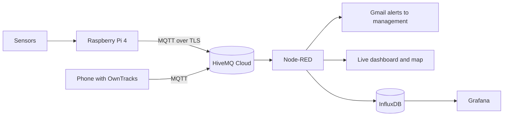

# Smart Helmet - Oil Site Worker Safety (IoT)

A smart safety helmet for workers on oil sites. Sensors inside the helmet watch for **fire risk, gas leaks, falls and loud noise**, warn the worker on the spot with a buzzer and an LCD, and alert management by email with the worker's location. All readings are stored and shown on live dashboards.

Final project for the **Samsung Innovation Campus - IoT** course.

> Status: working simulation (Wokwi) and a physical prototype on a Raspberry Pi 4.

---

## Table of contents

1. [The problem](#the-problem)
2. [The solution](#the-solution)
3. [Features](#features)
4. [System architecture](#system-architecture)
5. [Hardware](#hardware)
6. [Alert logic](#alert-logic)
7. [MQTT topics and payloads](#mqtt-topics-and-payloads)
8. [Software stack](#software-stack)
9. [Repository structure](#repository-structure)
10. [Getting started](#getting-started)
11. [Security notes](#security-notes)
12. [Known limitations](#known-limitations)
13. [Future work](#future-work)
14. [Team](#team)
15. [License](#license)

---

## The problem

Oil-site workers face dangers that are noticed too late:

- **Extreme heat** during outdoor shifts of 12 hours or more.
- **Explosive and toxic air**: methane can explode from one spark, and CO2 silently displaces breathable air.
- **Falls and impacts**: a worker who collapses alone may not be found quickly.

Today's alternatives (supervisor rounds, walkie-talkie calls, heat-stress training, a standard helmet that only protects from impact) all depend on a person. Nothing senses and reports automatically for each worker.

## The solution

A helmet that does four things:

1. **Detect** temperature, gas, falls and noise in real time.
2. **Warn** the worker immediately (buzzer + LCD).
3. **Alert** management by email, with a map link to the worker.
4. **Track** the worker's location and keep a history of every reading.

## Features

- **Wear detection**: the system starts only when the helmet is worn (IR sensor) and pauses when it is removed.
- **Fire warning** when the temperature goes above 45 C.
- **Fall warning** from a sudden jump in acceleration, with a cancel button to avoid false alarms.
- **Gas warning** from an MQ2 sensor.
- **Noise warning** after long exposure to loud sound (LCD + buzzer, no email).
- **Silence button** for the buzzer, and an independent **LED button** (toggle).
- **Email alerts** to management through Gmail (Node-RED).
- **Live dashboard** with gauges, status, alerts list and a worker map (Node-RED).
- **Worker location** from a phone running OwnTracks.
- **History and analytics** in InfluxDB and Grafana.
- **Wokwi simulation** so the logic can be tested without hardware.

## System architecture



## Hardware

### Physical prototype (Raspberry Pi 4)

| Part | Job |
|---|---|
| Raspberry Pi 4 | Main controller (Python) |
| DHT11 | Temperature (and humidity) |
| MQ2 gas sensor (DO output) | Gas detection |
| HW-484 sound sensor (DO output) | Noise detection |
| MPU6050 accelerometer | Fall detection |
| IR sensor | Helmet worn / removed |
| LCD 16x2 with I2C backpack | Messages for the worker |
| Buzzer | Audible alarm |
| LED + push button | LED on/off by button |
| Push button | Silence the buzzer / acknowledge |

Notes:

- The MQ2 module runs at 5 V. Its digital output is connected to the Raspberry Pi through **one diode** (stripe toward the sensor `DO`) with the Pi's internal pull-up enabled, or through a level shifter. Never connect a 5 V output directly to a GPIO.
- The sound module can run at 3.3 V, so its `DO` can go straight to a GPIO.
- The LCD (I2C) and MPU6050 share the I2C bus (`0x27` or `0x3F` for the LCD, `0x68` for the MPU6050).

### Pin mapping (BCM numbers, change them in the code if you wire differently)

| Function | GPIO |
|---|---|
| IR sensor | 17 |
| Sound sensor DO | 22 |
| MQ2 DO | 21 |
| Silence button | 24 |
| LED button | 16 |
| Buzzer | 18 |
| LED | 25 |
| DHT11 | 4 |
| I2C SDA / SCL | 2 / 3 |

### Wokwi simulation (Raspberry Pi Pico W, MicroPython)

| Real part | Wokwi part |
|---|---|
| DHT11 | DHT22 (GP2) |
| MQ2 | Gas sensor, analog output (GP27) |
| Sound sensor | Potentiometer (GP28) |
| IR sensor | HC-SR04 ultrasonic: distance under 20 cm = worn (GP16 / GP17) |
| MPU6050 | MPU6050 (I2C, GP4 / GP5) |
| LCD | LCD1602 I2C (GP4 / GP5) |
| Buzzer | Buzzer on GP15, driven with PWM |
| Button | Push button on GP14 |
| GPS | Simulated fixed coordinates (location comes from OwnTracks) |

## Alert logic

| Condition | Helmet reaction | Alert type | Email |
|---|---|---|---|
| Helmet worn | System starts, LCD shows "System started" | `info` | No |
| Temperature above 45 C | Buzzer + LCD warning | `fire` | Yes |
| Sudden jump in acceleration | Buzzer + LCD warning, button cancels | `fall` | Yes (if not cancelled in the simulation) |
| Gas detected | Buzzer + LCD warning | `gas` | Yes |
| Loud noise for a long time | Buzzer + LCD warning | `noise` | No (dashboard only) |

LCD priority when several alarms happen together: fall, fire, gas, noise.

Fall detection differs slightly between the two versions:

- **Wokwi simulation:** acceleration above 2.5 g starts a 5 second cancel window. If the worker presses the button, nothing is sent; otherwise the alert is sent. A flag prevents re-triggering until acceleration returns to normal.
- **Raspberry Pi prototype:** a change of 1.2 g or more between two readings counts as a fall, and the silence button acknowledges it.

## MQTT topics and payloads

Broker: **HiveMQ Cloud** (TLS, port 8883, username and password).

| Topic | Direction | Content |
|---|---|---|
| `so-m8k2/helmet/telemetry` | device to Node-RED | Readings every 2 seconds |
| `so-m8k2/helmet/alerts` | device to Node-RED | One message per event |
| `owntracks/+/+` | phone to Node-RED | Worker location (OwnTracks) |

Telemetry example:

```json
{"worn": 1, "status": "SAFE", "temp": 31.5, "gas": 0, "accel": 1.02, "noise": 0}
```

When the helmet is not worn: `{"worn": 0, "status": "NOT WORN"}`.

`status` is one of `SAFE`, `FIRE`, `GAS`, `FALL`, `NOISE`, `NOT WORN`. With the digital gas and sound sensors, `gas` and `noise` are `0` or `100`.

Alert example:

```json
{"type": "fire", "message": "High temperature detected", "temp": 47.2}
```

Alert types: `info`, `fire`, `fall`, `gas`, `noise`.

## Software stack

| Tool | Role |
|---|---|
| Python 3 / MicroPython | Device code (Raspberry Pi 4 / Pico W) |
| MQTT (HiveMQ Cloud) | Messaging |
| Node-RED | Alert logic, Gmail emails, dashboard, map |
| OwnTracks | Worker location from a phone |
| InfluxDB v2 | Time-series storage |
| Grafana | History dashboard |
| Wokwi | Simulation |

### Node-RED

Required palettes: `node-red-dashboard`, `node-red-node-email`, `node-red-contrib-web-worldmap`, `node-red-contrib-influxdb`.

The flow:

- Subscribes to telemetry, alerts and OwnTracks.
- Builds the alert email (message, readings, Google Maps link) and sends it with the Gmail SMTP node (use an **App Password**).
- Uses the OwnTracks location when it is fresh (less than 5 minutes old), otherwise the device location.
- Drives the dashboard at `http://<node-red-ip>:1880/ui` and the map at `http://<node-red-ip>:1880/worldmap/`.
- Writes every telemetry message to InfluxDB.

### InfluxDB

- Organization `smart-helmet`, bucket `helmet_data`, measurement `helmet_telemetry`.
- Tags: `device_id`, `status`.
- Fields: `temp`, `gas`, `accel`, `noise`, `lat`, `lon`, `worn`.

### Grafana

Dashboard "Smart Helmet - Oil Site Safety" with the worker status, helmet on/off, location map, temperature, gas, noise, history chart and an event timeline. Data source: InfluxDB (Flux) with a read-only token.

Example Flux query (current temperature):

```flux
from(bucket: "helmet_data")
  |> range(start: -1m)
  |> filter(fn: (r) => r._measurement == "helmet_telemetry" and r._field == "temp")
  |> group()
  |> sort(columns: ["_time"])
  |> last()
```

## Repository structure

Adjust the names to match your repository.

```
smart-helmet/
├── raspberry_pi/
│   └── helmet.py              # Raspberry Pi 4 prototype code
├── wokwi/
│   ├── main.py                # Pico W MicroPython code
│   ├── diagram.json           # Wokwi circuit
│   └── umqtt_simple.py        # MQTT client used on Wokwi
├── node_red/
│   └── flows.json             # Node-RED flow (no credentials)
├── grafana/
│   └── dashboard.json         # Grafana dashboard
├── docs/
│   ├── architecture.png
│   └── presentation.pdf
├── .gitignore
└── README.md
```

## Getting started

### 1. Raspberry Pi 4

```bash
sudo raspi-config                  # Interface Options -> I2C -> Enable
sudo apt update
sudo apt install -y python3-pip python3-venv i2c-tools libgpiod2

python3 -m venv --system-site-packages ~/helmet-env
source ~/helmet-env/bin/activate
pip install paho-mqtt smbus2 RPLCD adafruit-circuitpython-dht

i2cdetect -y 1                     # LCD (27 or 3f) and MPU6050 (68) should appear
```

Open the code and set your HiveMQ username and password (see [Security notes](#security-notes)), then:

```bash
python3 raspberry_pi/helmet.py
```

### 2. Wokwi simulation

1. Create a Raspberry Pi Pico W project in Wokwi and paste `diagram.json`.
2. Add `main.py` and the local `umqtt_simple.py` file.
3. Put your HiveMQ host, user and password in `main.py` (or set `USE_TLS = False` to test on a public broker).
4. Press play. Set the HC-SR04 distance below 20 cm so the helmet counts as worn.

### 3. Cloud and dashboards

1. Create a HiveMQ Cloud cluster and a credential with publish and subscribe permission.
2. Install the Node-RED palettes, import `flows.json`, and enter the broker credentials and the Gmail App Password in the nodes.
3. Create the InfluxDB organization, bucket and tokens, then import the Grafana dashboard.
4. OwnTracks app: Mode = MQTT, host = your HiveMQ host, port = 8883, TLS on, same credentials.

## Security notes

- **Never commit real credentials.** Use placeholders in the repository (`YOUR_USER`, `YOUR_PASSWORD`, `YOUR_INFLUX_TOKEN`) and keep the real values in a local file that is in `.gitignore`.
- Use a strong HiveMQ password. If a password was ever shown in a screenshot or pushed to GitHub, change it.
- Use a Gmail **App Password** for the email node, not your normal password.
- OwnTracks sends a real location: keep the topic protected with credentials.

## Known limitations

- The digital outputs of the MQ2 and the sound sensor only give "detected / not detected" (`0` or `100`), not a measured level. Sensitivity is set with the small potentiometer on each module.
- MQ2 needs a warm-up of a few minutes before its output is reliable, and it detects flammable gases and smoke, not oxygen.
- DHT11 accuracy is about 2 C and it can be read at most once per second.
- MPU6050 must be set to a wider range than the default +-2 g to see strong impacts.
- The fall rule is a simple threshold and can give false alarms or miss slow falls. The cancel button reduces false alerts.
- The Wokwi simulation replaces some parts (potentiometer for sound, ultrasonic for the IR sensor).

## Future work

- Real gas concentration with an analog gas sensor and an ADC.
- A real GPS module on the helmet instead of the phone.
- An oxygen sensor or SpO2 sensor (MAX30102) for worker vitals.
- Editable thresholds from the dashboard.
- A smarter fall detector (impact followed by no movement).
- Helmet casing, battery power and a final design.

## Team

| Name | Role |
|---|---|
| [Name] | [Role] |
| [Name] | [Role] |

## License

[Choose a license, for example MIT, and add a LICENSE file.]